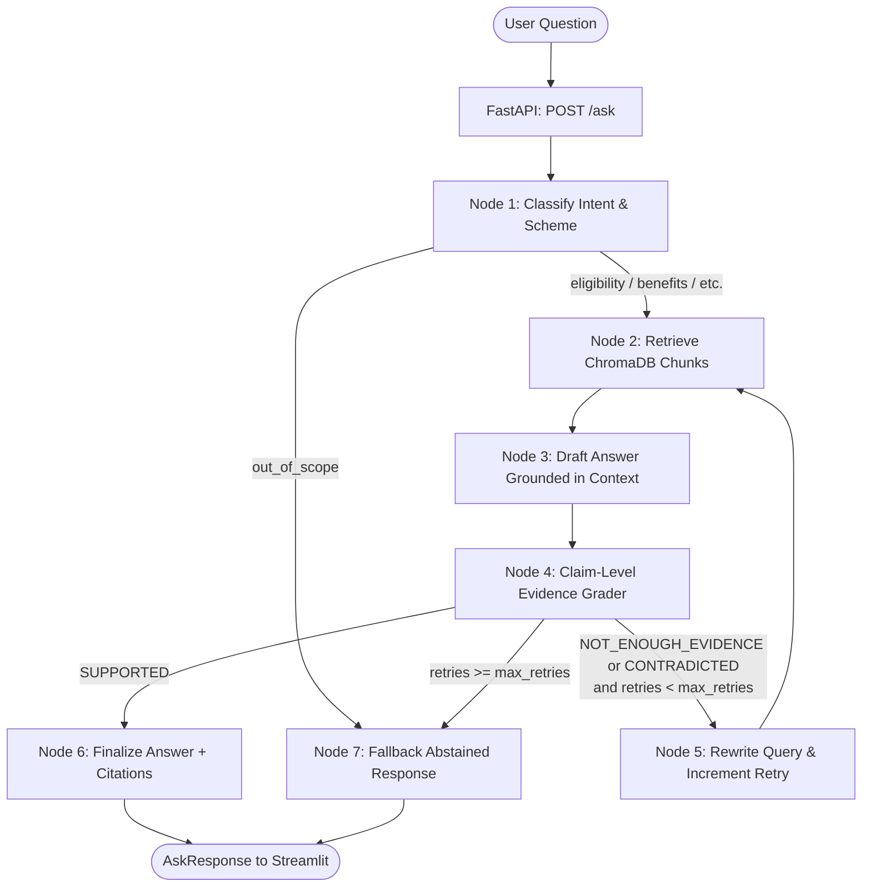

# TrustYojana (v2) 🇮🇳

**TrustYojana** is an end-to-end, verifiable RAG (Retrieval-Augmented Generation) question-answering system for Indian government welfare schemes (such as **PM-KISAN**, **Ayushman Bharat PM-JAY**, **National Means-cum-Merit Scholarship Scheme (NMMSS)**, and **PM SVANidhi**).

TrustYojana answers queries **only when retrieved official scheme documents strictly support the facts**. If the evidence is insufficient or contradicted, the system safely abstains with an explicit, helpful fallback message.

---

## 🏗️ Architecture & Integrated Workflow

TrustYojana is developed as **one integrated application** incorporating the three lab experiment components:
- **Experiment 5 (Document-based RAG):** Document ingestion (PyMuPDF/HTML/TXT), cleaning, chunking (`RecursiveCharacterTextSplitter`), embeddings (`BAAI/bge-small-en-v1.5`), persistent ChromaDB with incremental file-hash change detection, and basic retrieval.
- **Experiment 6 (LangChain / LangGraph Workflow):** StateGraph workflow coordinating intent classification, scheme detection, personal eligibility analysis (stateless single-turn criteria breakdown), claim-level LLM evidence checking (`SUPPORTED` / `NOT_ENOUGH_EVIDENCE` / `CONTRADICTED`), query rewriting with retry loops, and safe fallback.
- **Experiment 7 (FastAPI & Streamlit):** High-performance asynchronous REST API with validation, middleware-based request tracking (`X-Request-ID`), privacy-preserving logging (logs question length and hash only, no question text), health monitoring (independent vector DB and LLM connectivity), and a Streamlit chat UI.



---

## 📂 Project Structure

```text
trustyojana/
  ├── README.md               # Complete project documentation and guide
  ├── requirements.txt        # Python 3.11 dependencies
  ├── config.yaml             # Central configuration (models, chunking, paths, ports)
  ├── .env.example            # Template for environment variables and API keys
  ├── data/
  │   ├── raw/                # Official scheme PDFs (PM-KISAN, Ayushman Bharat, NMMSS, PM SVANidhi)
  │   ├── processed/          # Cleaned documents saved for inspection
  │   └── sources.csv         # Metadata mapping (filename, scheme, title, url, doc_date, date_accessed)
  ├── chroma_db/              # Persistent ChromaDB vector database
  ├── logs/
  │   └── api.log             # Rotating API log (privacy-preserving)
  ├── src/
  │   ├── __init__.py
  │   ├── config.py           # Configuration loader (.env and config.yaml)
  │   ├── llm.py              # Provider-agnostic LLM wrapper (OpenAI, Gemini, Anthropic, Ollama)
  │   ├── generate_docs.py    # Official scheme document generator
  │   ├── ingest.py           # Document cleaning, chunking, hashing, and Chroma indexing
  │   ├── retriever.py        # Top-k retrieval with metadata filtering
  │   ├── rag_chain.py        # Basic retrieve-and-answer pipeline (Exp 5)
  │   ├── prompts.py          # Centralized prompts
  │   └── workflow.py         # LangGraph StateGraph workflow (Exp 6)
  ├── api/
  │   ├── __init__.py
  │   ├── main.py             # FastAPI app with health checks, /ask, /schemes (Exp 7)
  │   └── schemas.py          # Pydantic models (AskRequest, AskResponse, HealthResponse, etc.)
  ├── app/
  │   └── streamlit_app.py    # Streamlit chat interface (Exp 7)
  └── tests/
      ├── __init__.py
      ├── test_ingest.py      # Tests for text cleaning, chunking, and hash skip logic
      ├── test_workflow.py    # Tests for JSON parsing, routing, and mock workflow
      └── test_api.py         # FastAPI TestClient tests for validation, health, and privacy logging
```

---

## ⚙️ Installation & Setup

### 1. Prerequisites
- **Python 3.11** installed.
- No GPU required (embeddings run efficiently on CPU via PyTorch and SentenceTransformers).

### 2. Virtual Environment Setup
Open a terminal in the project directory:

```bash
# Windows
py -3.11 -m venv venv
.\venv\Scripts\activate

# macOS / Linux
python3.11 -m venv venv
source venv/bin/activate
```

### 3. Install Dependencies
```bash
pip install -r requirements.txt
```

### 4. Configure Environment Variables
Copy `.env.example` to `.env`:
```bash
cp .env.example .env
```

Open `.env` and configure your preferred LLM provider and credentials:
```env
LLM_PROVIDER=openai
LLM_MODEL=gpt-4o-mini
OPENAI_API_KEY=your-actual-api-key-here

# Alternatively for Google Gemini:
# LLM_PROVIDER=gemini
# LLM_MODEL=gemini-1.5-flash
# GEMINI_API_KEY=your-actual-gemini-key-here
```

All other parameters (chunk size `800`, overlap `100`, top-k `4`, max retries `2`) can be reviewed or tuned in [`config.yaml`](file:///c:/Users/HETANSHI%20SHAH/Desktop/LLM_Lab/ESE/config.yaml).

---

## 📥 Ingestion & Document Refresh

### Step 1: Ingest Scheme Documents
Run the ingestion pipeline to clean text, generate embeddings (`BAAI/bge-small-en-v1.5`), and index into persistent ChromaDB:

```bash
python -m src.ingest
```

### Step 2: Incremental Updates (Content Hash Logic)
The ingestion tool automatically computes SHA-256 hashes of all source files.
- If you run `python -m src.ingest` again without changes, unchanged files are **skipped** in seconds.
- When an existing document is modified, only that document's chunks are deleted and re-indexed.
- To completely wipe and rebuild the vector database from scratch:
  ```bash
  python -m src.ingest --reset
  ```

### How to Add New Schemes Manually
1. Place the new PDF, HTML, or TXT file into `data/raw/` (e.g. `data/raw/new_scheme.pdf`).
2. Add a new row to `data/sources.csv`:
   ```csv
   filename,scheme,title,url,doc_date,date_accessed
   new_scheme.pdf,New Scheme Name,Official Guidelines,https://scheme.gov.in,2024-01-01,2024-10-30
   ```
3. Run `python -m src.ingest`.

---

## 🚀 Running the Application

To experience the full end-to-end application, start the FastAPI backend and Streamlit frontend in two separate terminals.

### Terminal 1: Launch FastAPI Backend
```bash
# Activate venv if not active
.\venv\Scripts\activate

uvicorn api.main:app --reload --host 0.0.0.0 --port 8000
```
- API Docs (Swagger UI): `http://127.0.0.1:8000/docs`
- Health Check: `http://127.0.0.1:8000/health`
- Live LLM Deep Health Check: `http://127.0.0.1:8000/health?deep=true`
- Indexed Schemes: `http://127.0.0.1:8000/schemes`

### Terminal 2: Launch Streamlit Frontend
```bash
# Activate venv if not active
.\venv\Scripts\activate

streamlit run app/streamlit_app.py
```
- Web Application UI: `http://localhost:8501`

---

## 🧪 Testing TrustYojana Features

The Streamlit interface includes quick sample buttons representing key system capabilities:

1. **Answerable Factual Question:**
   - *Example:* "What is the financial assistance provided under PM-KISAN and how is it disbursed?"
   - *Result:* Direct grounded answer citing Rs 6,000 in 3 installments of Rs 2,000 via DBT, with page-level citations from `pm_kisan_guidelines.pdf`.
2. **Personal Eligibility (Stateless Single-Turn Assessment):**
   - *Example:* "Am I eligible for PM-KISAN? I own 2 acres of land and my family does farming."
   - *Result:* Lists criteria, marks land ownership as **Met**, marks exclusion criteria (Income tax, government job, constitutional post) as **Unknown**, provides an explicit **Information Needed** list, states insufficient information to decide, and prints the mandatory disclaimer: *"This is not an official eligibility decision; confirm with the official scheme website or office."*
3. **Unanswerable / Unsupported Question:**
   - *Example:* "Can I purchase a tractor using an Ayushman Bharat card?"
   - *Result:* Safely abstains with *"I don't have enough information in the available scheme documents to answer this reliably. Please check the official scheme website."*
4. **Out-of-Scope Query:**
   - *Example:* "How do I make authentic Hyderabadi biryani?"
   - *Result:* Classified as `out_of_scope` and routes directly to the fallback notice without making vector store retrieval calls.
5. **Freshness & Document Traceability:**
   - Every answer displays a freshness notice: *"Based on documents last accessed on 2024-10-15. Scheme rules change, so verify on the official website."*
   - Expand the **Cited Sources** accordion to view document title, page numbers, text snippets, official URLs, and access dates.
   - Expand the **Execution Trace** accordion to view latency, retry count, and node-by-node execution path.
6. **Privacy Preserving Server Logs:**
   - Check `logs/api.log`: User question text is **never stored or logged**. Only question length, a SHA-256 hash prefix, intent, scheme, verdict, retries, and latency are recorded.

---

## 🔬 Running Unit Tests

Run the full automated test suite covering all components:

```bash
.\venv\Scripts\pytest -v tests
```

Tests include:
- `tests/test_ingest.py`: Header/footer cleaning, hyphenated wrap resolution, whitespace normalization, SHA-256 hash detection, and text splitting.
- `tests/test_workflow.py`: Robust JSON parsing, missing information extraction, conditional edge routing for all verdicts (`SUPPORTED`, `NOT_ENOUGH_EVIDENCE`, `CONTRADICTED`, `out_of_scope`), and full mocked workflow execution.
- `tests/test_api.py`: FastAPI `TestClient` tests for input validation (422), standard and deep health checks (200 / 503), scheme listing, and verification that question text is excluded from logs.
